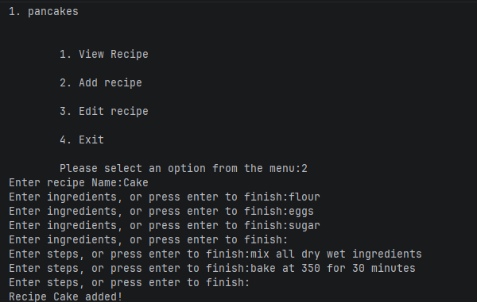

# Project Overview
This project is a simple command-line recipe book where users can add, view, and edit recipes. The application stores recipes in a list of dictionaries, gives users options through prompts, and uses iteration to handle interactions with recipes.

## Key Features & Usage Example
After running the application, the user is presented with a menu of options. They can:

* View their existing recipes
* Add a new recipe
* Edit their existing recipes 
* Exit the application
In the screenshot below, you can see a user selecting the "Add recipe" option and entering recipe details.


## How to Run
From the project root, run:
```sh
python3 src/main.
```